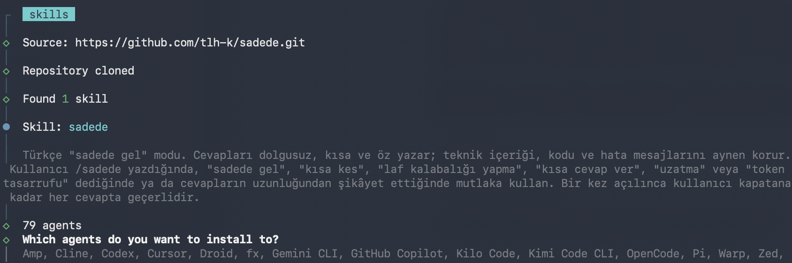
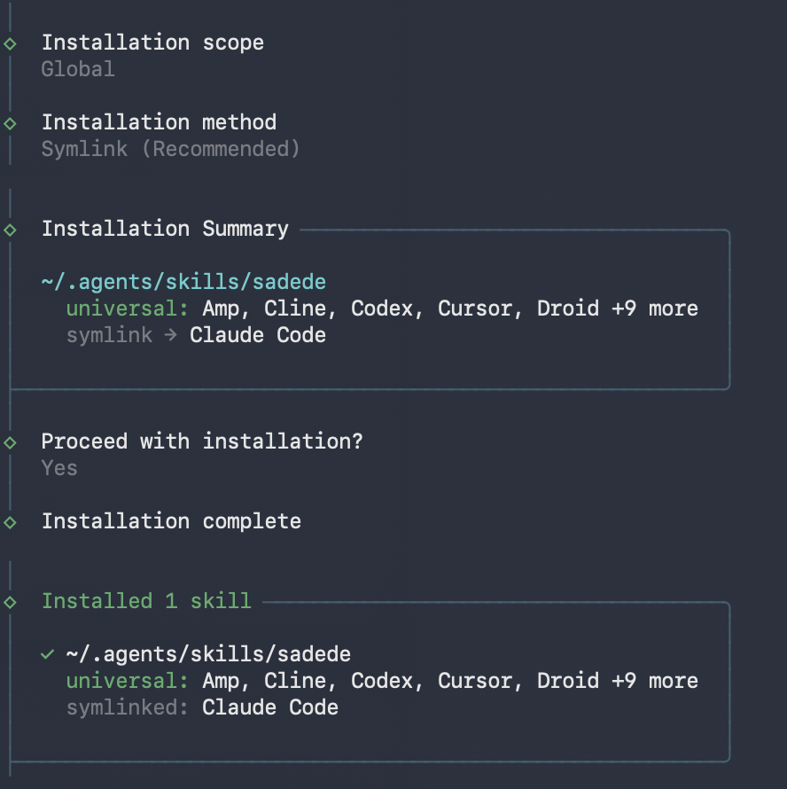

# Sadede

> **Az söyle, öz söyle.**

AI asistanların cevaplarını dolgusuz, kısa ve öz hâle getiren Türkçe skill. Teknik içerik, kod ve hata mesajları aynen kalır; sadece laf kalabalığı gider.

## Önce / sonra

**Normal:**

> Tabii ki yardımcı olabilirim! Container'ınızın başlar başlamaz kapanmasının sebebi büyük ihtimalle, Docker'ın container içindeki ana process sona erdiğinde container'ı da durdurmasından kaynaklanıyor olabilir. Bu nedenle `CMD` satırınızda ön planda çalışmaya devam eden bir komut bulunması gerekmektedir. Sorunu daha detaylı incelemek için `docker logs` komutunu kullanmanızı öneririm. Umarım yardımcı olur!

**`/sadede`:**

> Ana process bitiyor -> container kapanıyor. `CMD` ön planda çalışan komut olmalı. Log: `docker logs <id>`.

## Neden Türkçe?

Türkçenin kendine has dolguları var: "gerçekleştirmek / sağlamak" fiil zincirleri, "-mektedir" ekleri, gereksiz "-dır/-dir", artikel gibi kullanılan "bir". Sadede bunları hedefler. Türkçe, ekli yapısı yüzünden İngilizceden daha çok token harcadığı için kısaltmanın getirisi de daha yüksek.

## Kurulum

### Hızlı kurulum (Claude Code)

```bash
npx skills add tlh-k/sadede -g -a claude-code -y
```

Hiçbir şey sormadan kurar ve tüm projelerde geçerli olur. Başka agent'lar için `-a` sonrasını değiştir veya birden fazla ekle (`-a claude-code -a codex`).

### Adım adım kurulum

Seçimleri kendin yapmak istersen bayraksız çalıştır:

```bash
npx skills add tlh-k/sadede
```

**1. Repo indirilir, skill bulunur.** `Found 1 skill` ve `Skill: sadede` satırlarını görürsün. Ardından araç hangi agent'lara kurulacağını sorar.



**2. Agent'ları seç.** `Which agents do you want to install to?` ekranında Amp, Codex, Cursor, Gemini CLI, GitHub Copilot gibi ortak `.agents/skills` klasörünü okuyan agent'lar varsayılan olarak seçili gelir. Claude Code kendi klasörünü kullandığı için seçili gelmez: ok tuşlarıyla Claude Code'a in, **Space** ile işaretle, **Enter** ile onayla.

**3. Kapsam: `Global`.** `Installation scope` sorusunda Global'i seç. Project seçersen skill sadece komutu çalıştırdığın klasörde çalışır.

**4. Yöntem: `Symlink (Recommended)`.** Tek kopya `~/.agents/skills/sadede` altında tutulur, Claude Code ona bağlanır. Güncellemeler tüm agent'lara birden yansır.

**5. Özeti kontrol et, onayla.** Özette `universal` satırında ortak agent'lar, altında `symlink → Claude Code` görünmeli. `Proceed with installation?` sorusuna **Yes** de.



**6. Kullan.** Yeni bir Claude Code oturumu aç ve `/sadede` yaz.

### Manuel kurulum (Claude Code, npx olmadan)

```bash
git clone https://github.com/tlh-k/sadede.git
mkdir -p ~/.claude/skills
cp -r sadede/skills/sadede ~/.claude/skills/
```

### Diğer asistanlar (ChatGPT, Gemini vb.)

`skills/sadede/SKILL.md` dosyasının içeriğini (en üstteki `---` arasındaki kısım hariç) asistanın özel talimat / sistem prompt alanına yapıştır.

## Kullanım

| | |
|---|---|
| Aç | `/sadede`, "sadede gel", "kısa kes" |
| Kapat | "normal mod", "sadede kapat" |

Güvenlik uyarıları, geri alınamaz işlemler ve sırası önemli talimatlarda geçici olarak açık Türkçeye döner, sonra kısa üsluba devam eder.

## Ne atar, ne korur

| Atar | Korur |
|---|---|
| "Tabii!", "Harika soru", "Umarım yardımcı olur" | Teknik terimler |
| aslında, yani, temelde, açıkçası | Kod blokları |
| "gerçekleştirmek", "-mektedir", gereksiz "-dır" | Birebir hata mesajları |
| Süs çekinceler, soruyu tekrar etme, kapanış özeti | Türkçe karakterler ve doğru yazım |

## Lisans

[MIT](LICENSE)
